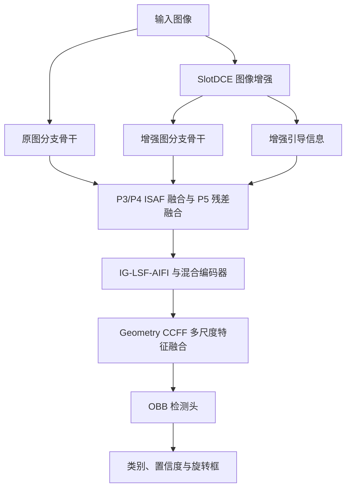

# DSH-OBB

**面向低照度煤矿场景的旋转目标检测模型。**

DSH-OBB 将图像增强、原图与增强图的特征融合、混合编码器和几何引导融合结合到旋转框检测框架中。本仓库提供模型实现、训练配置、验证、逐图可视化及论文指标汇总工具。

> **命名说明**：论文和本文档统一使用 **DSH-OBB**。为兼容已有 checkpoint，代码目录 `Slot-YOLO/`、Python 包 `slot_yolo` 和配置值 `model_type: slot_yolo` 保留原名。运行命令中的这些标识需要原样使用。

## 目录

- [模型概览](#模型概览)
- [仓库结构](#仓库结构)
- [环境安装](#环境安装)
- [数据准备](#数据准备)
- [权重准备](#权重准备)
- [训练](#训练)
- [验证与论文评估](#验证与论文评估)
- [检测可视化](#检测可视化)
- [常见问题](#常见问题)
- [致谢与引用](#致谢与引用)

## 模型概览

当前完整模型由以下部分组成：

| 组成部分 | 实现与作用 |
| --- | --- |
| YOLOv8s 骨干 | 基于 C2f 和 SPPF 提取 P3/P4/P5 多尺度特征 |
| SlotDCE | 对输入图像进行增强，并产生供特征融合使用的引导信息 |
| 双分支特征提取 | 分别处理原图和增强图；共享非 BN 参数，各分支保留独立 BN 参数及统计量 |
| ISAF | 在 P3/P4 融合原图与增强图特征；P5 使用独立残差融合 |
| RTDETRV2_hyE_yolo + IG-LSF-AIFI | 对 P5 进行增强与注意力建模，并组织多尺度特征交互 |
| Geometry CCFF | 利用预测的前景、主轴和尺度信息进行几何引导融合；训练时可使用 OBB 几何辅助监督 |
| OBB 检测头 | 输出类别、置信度和旋转框 |



仓库保留两种几何融合实现：

| 版本 | 配置模板 | 区别 |
| --- | --- | --- |
| Geometry CCFF v1 | [config_RTDETRV2_hyE_yolo_geometry.yaml](ex_config/config_RTDETRV2_hyE_yolo_geometry.yaml) | 在原生 CCFF 的 P3 上加入几何引导修正 |
| Geometry CCFF v1.1 | [config_RTDETRV2_hyE_yolo_geometry_v1_1.yaml](ex_config/config_RTDETRV2_hyE_yolo_geometry_v1_1.yaml) | 在 P5→P4→P3→P4→P5 路径中进行双向几何融合 |

本文训练示例显式使用 **v1**，与当前最终模型的几何融合版本对应。训练和普通验证脚本不传 `--config` 时默认选 **v1.1**，因此复现时请始终显式指定配置。两版应使用各自匹配的权重；`module_version: v2` 是另一套内部模块版本标识，不代表 Geometry CCFF v1.1。

实现细节见 [Geometry CCFF v1](docs/GEOMETRY_CCFF.md) 与 [Geometry CCFF v1.1](docs/GEOMETRY_CCFF_V1_1.md)。

## 仓库结构

以下命令均从**包含 `pyproject.toml` 和 `ultralytics/` 的仓库根目录**执行：

```text
DSH-OBB/                         # 克隆后的仓库名称可自定义
├── README.md
├── pyproject.toml               # 本地 Ultralytics 包及依赖声明
├── ultralytics/                 # 本项目使用的 Ultralytics 源码
└── Slot-YOLO/                   # DSH-OBB 实现目录，保留兼容名称
    ├── README.md
    ├── train.py                 # 训练入口
    ├── test.py                  # 验证入口，可按配置附带预测
    ├── check_model.py           # 小尺寸前向/反向检查
    ├── run_paper_evaluation.py  # 论文指标统一评估
    ├── run_ocm_visualization.py # OCM v1 权重的逐图可视化
    ├── common.py
    ├── backbone_config.py
    ├── ig_config.py
    ├── module_version.py
    ├── rtdetrv2_hye_config.py
    ├── datasets_config/        # 数据集路径与类别定义
    ├── ex_config/              # 训练、验证、可视化与论文评估配置
    ├── model_config/           # 骨干及检测头结构配置
    ├── slot_pt/                # SlotDCE 初始化权重
    ├── slot_yolo/              # 模型、训练器及各模块实现
    └── docs/                   # 结构与评估协议说明
```

发布和复现需要同时保留 `ultralytics/`、`pyproject.toml` 与 `Slot-YOLO/`。仅复制模型子目录并安装 PyPI 上的同名包，不能保证与当前自定义实现兼容。

## 环境安装

### 1. 获取源码

将 `<YOUR_REPOSITORY_URL>` 替换为实际 GitHub 仓库地址：

```bash
git clone <YOUR_REPOSITORY_URL> DSH-OBB
cd DSH-OBB
```

### 2. 创建环境

参考运行环境为 Linux、Python 3.10、PyTorch 2.5.1 + CUDA 12.1；已有服务器日志使用 NVIDIA RTX 4090。GPU 型号及显存需求随输入分辨率、batch 和模块配置变化。

```bash
conda create -n dsh-obb python=3.10 -y
conda activate dsh-obb
python -m pip install --upgrade pip "setuptools>=70,<81" wheel
```

### 3. 安装 PyTorch 与项目依赖

以下命令使用 PyTorch 官方 CUDA 12.1 wheel，需配合兼容的 NVIDIA 驱动。PyTorch 与 TorchVision 的版本组合见 [PyTorch 官方历史版本安装说明](https://pytorch.org/get-started/previous-versions/#v251)。

```bash
python -m pip install torch==2.5.1 torchvision==0.20.1 --index-url https://download.pytorch.org/whl/cu121
python -m pip install numpy==1.26.4 opencv-python==4.11.0.86
python -m pip install -e .
python -m pip check
```

这里固定 NumPy 和 OpenCV 作为新环境的安装基线，并非原训练服务器的完整依赖快照。其余依赖由根目录的 `pyproject.toml` 安装，包括 PyYAML、Pillow、Matplotlib、Polars 和 Ultralytics THOP 等。训练与评估不需要安装 `pytest`；论文评估脚本也不依赖 `pycocotools`。

`pip install -e .` 安装的是本仓库源码，当前源码版本号为 `8.4.90`。后续实验请保留相同代码版本及依赖环境。

### 4. 检查安装

```bash
python -c "import torch, torchvision, ultralytics; print('torch:', torch.__version__); print('torchvision:', torchvision.__version__); print('CUDA:', torch.version.cuda, torch.cuda.is_available()); print('ultralytics:', ultralytics.__version__, ultralytics.__file__)"
python -c "import sys; sys.path.insert(0, 'Slot-YOLO'); import slot_yolo; print('DSH-OBB modules imported successfully')"
```

用于 GPU 训练时，`torch.cuda.is_available()` 应为 `True`，`ultralytics.__file__` 应指向当前仓库。可保存实际安装环境供复现：

```bash
python -m pip freeze > environment-pip.txt
```

## 数据准备

### 1. OBB 标注格式

使用 YOLO OBB 四顶点格式，每行一个目标：

```text
class_id x1 y1 x2 y2 x3 y3 x4 y4
```

`class_id` 从 0 开始；四个顶点沿框周边依次排列，坐标分别按原图宽、高归一化到 `[0, 1]`。例如：

```text
0 0.10 0.20 0.40 0.20 0.40 0.50 0.10 0.50
```

图像与标签必须同名，标签扩展名为 `.txt`：

```text
dataset/
├── images/
│   ├── train/example.jpg
│   ├── val/example.jpg
│   └── test/                  # 仅数据集提供 test 时存在
└── labels/
    ├── train/example.txt
    ├── val/example.txt
    └── test/
```

### 2. 数据 YAML

修改 [OCM.yaml](datasets_config/OCM.yaml) 和 [CMDPC.yaml](datasets_config/CMDPC.yaml) 的 `path`，指向本机数据根目录。数据不随代码自动下载。

OCM 示例：

```yaml
path: /absolute/path/to/OCM
train: images/train
val: images/val
test: images/test
names:
  0: Drill_body
  1: Drill_tail
  2: Drill_head
  3: Drill_pipe
  4: Drill_bit
  5: worker
```

CMDPC 示例：

```yaml
path: /absolute/path/to/CMDPC_yolo_obb
train: images/train
val: images/val
names:
  0: Drill_body
  1: Drill_head
  2: Drill_pipe
  3: Drill_tail
```

已训练的 CMDPC 五类权重使用 `4=Drill_tail`；当前使用的数据版本中 `3=Drill_pipec` 为空类别。即使某类没有 GT，也应保留训练时的类别编号和检测头输出定义。不要把 `4` 压缩为 `3` 后继续直接评估原五类权重。只有实际采用不同类别体系并重新训练时，才应相应调整定义。

如曾修改过标签编号，请先核对原始标注和权重的训练定义；项目已有的编号恢复工具说明见 [评估文档](docs/paper_evaluation.md)。

## 权重准备

| 权重 | 用途 | 配置位置 |
| --- | --- | --- |
| `Slot-YOLO/slot_pt/best_loss.pth` | SlotDCE 初始化 | 训练 YAML 的 `enhancer.weights` |
| 对应数据集的 `best.pt` | 完整 DSH-OBB 验证、预测和论文评估 | `test.weights`、评估 YAML 的 `experiments[].weights` 或命令行 `--weights` |
| 同一实验的 `last.pt` | 恢复中断的训练 | 匹配结构的训练配置及 `train.resume` |

默认配置为 `enhancer.pretrained: true`，训练前需准备相应 SlotDCE 初始化文件。检测器的 `train.pretrained: false` 表示检测器从头训练，与增强器是否使用初始化权重是两个独立设置。

已有完整检测 checkpoint 时，可直接用于验证和预测；不需要重新进行增强器初始化训练。公开检测权重的下载地址将在发布后补充，目前请将自己训练或已获取的权重路径写入配置。

## 训练

### 1. 创建本机实验配置

仓库现有 YAML 保留了开发环境的绝对路径、GPU 编号和输出目录。先复制完整 v1 模板，再修改本机设置：

```bash
cp Slot-YOLO/ex_config/config_RTDETRV2_hyE_yolo_geometry.yaml Slot-YOLO/ex_config/dsh_obb_ocm.yaml
cp Slot-YOLO/ex_config/config_RTDETRV2_hyE_yolo_geometry.yaml Slot-YOLO/ex_config/dsh_obb_cmdpc.yaml
```

在复制后的文件中更新下列字段，**保留模板中的其他配置**：

| 字段 | OCM 示例 | CMDPC 示例 |
| --- | --- | --- |
| `data` | `../datasets_config/OCM.yaml` | `../datasets_config/CMDPC.yaml` |
| `train.device` | `0` | `0` |
| `train.output_dir` | `../newoutput/DSH-OBB_OCM` | `../newoutput/DSH-OBB_CMDPC` |
| `test.weights` | `null`，或该数据集的权重绝对路径 | `null`，或该数据集的权重绝对路径 |
| `test.split` | `val` | `val` |
| `test.device` | `0` | `0` |
| `test.output_dir` | `../newoutput/eval_DSH-OBB_OCM` | `../newoutput/eval_DSH-OBB_CMDPC` |

`test.weights: null` 时，脚本会按训练配置定位默认 `weights/best.pt`；若训练输出目录被自动编号递增，验证时请用 `--weights` 明确指定实际文件。

训练 YAML 中的相对文件路径以该 YAML 所在目录为基准。`enhancer.weights` 和 `enhancer.architecture_config` 也需存在；文件名中带 OCM 不会自动选择 OCM，实际数据由 `data` 字段决定。

### 2. 训练前检查

准备好增强器权重后，可先做小尺寸结构检查：

```bash
python Slot-YOLO/check_model.py --config Slot-YOLO/ex_config/dsh_obb_ocm.yaml --imgsz 128
# 可选：同时检查反向传播
python Slot-YOLO/check_model.py --config Slot-YOLO/ex_config/dsh_obb_ocm.yaml --imgsz 128 --backward
```

该入口使用合成输入，仅检查构建和计算流程，不产生检测精度结论。

### 3. 开始训练

```bash
python Slot-YOLO/train.py --config Slot-YOLO/ex_config/dsh_obb_ocm.yaml
python Slot-YOLO/train.py --config Slot-YOLO/ex_config/dsh_obb_cmdpc.yaml
```

模板主要设置为 `epochs=100`、`imgsz=640`、`batch=16`、`seed=0`、`amp=true`。增强器前 5 个 epoch 冻结，随后以较小学习率参与优化，具体以实验 YAML 为准。当前自定义训练入口支持单进程、单 GPU。

训练产物位于 `train.output_dir` 对应目录，包括 `weights/best.pt`、`weights/last.pt`、`results.csv` 和 `train.log`。若需使用 v1.1，从对应 v1.1 模板另建配置和输出目录，不要用另一结构的 checkpoint 续训。

## 验证与论文评估

### 1. 普通验证

```bash
python Slot-YOLO/test.py --config Slot-YOLO/ex_config/dsh_obb_ocm.yaml --weights /absolute/path/to/ocm/best.pt
python Slot-YOLO/test.py --config Slot-YOLO/ex_config/dsh_obb_cmdpc.yaml --weights /absolute/path/to/cmdpc/best.pt
```

`test.py` 是普通运行脚本，无需测试框架。实际划分由 YAML 中的 `test.split` 决定；设置为 `val` 就是验证集结果。CMDPC 没有独立测试集时使用 `val`，论文表格也应标注为验证集。

### 2. 两个数据集统一评估

修改 [ex_config/paper_evaluation.yaml](ex_config/paper_evaluation.yaml)：

- `evaluation.device`：本机 GPU 编号，也可通过 `--device` 覆盖。
- `experiments[].weights`：分别填写 OCM、CMDPC 的对应权重。
- `experiments[].data_root`：本机数据根目录，该值会覆盖数据 YAML 的 `path`。
- `experiments[].method`：设为 `DSH-OBB`，用于汇总表中的方法名。
- `experiments[].split`：当前统一采用 `val`。

```bash
# 默认依次评估 OCM、CMDPC 并汇总
python Slot-YOLO/run_paper_evaluation.py --device 0
# 单独评估一个数据集
python Slot-YOLO/run_paper_evaluation.py --only OCM --device 0
python Slot-YOLO/run_paper_evaluation.py --only CMDPC --device 0
```

**当前配置的精度评估与测速采用 `imgsz=640、batch=1、rect=false、FP32`，FPS 使用本次原生验证的计时。** 脚本也支持配置独立的 `speed_benchmark`；如启用，应同时记录精度阶段和测速阶段的参数。改变 `rect`、batch、分辨率或数据划分后，应重新评估全部对比模型，不与旧条件下的数值混用。最终以每次输出的 `config.snapshot.yaml` 和 `protocol.json` 为准。

| 指标 | 计算口径 |
| --- | --- |
| mAP50 / mAP75 | IoU 阈值分别为 0.50 / 0.75 的类别平均 AP |
| mAP50-95 | IoU 阈值 0.50:0.05:0.95 的平均 AP |
| 每类 AP50 | 每个类别在 IoU=0.50 下的 AP |
| APS / APM / APL | 各尺寸组的 AP50-95，不是 AP50 |
| Params(M) | 推理融合前模型全部唯一参数数目 / 1e6 |
| GFLOPs | 配置输入尺寸下 batch=1 的完整 FP32 forward，torch profiler 统计，1 MAC 按 2 FLOPs 计 |
| FPS(infer) | `1000 / inference_ms_per_image` |
| FPS(pipe) | `1000 / (preprocess_ms + inference_ms + postprocess_ms)` |

尺寸按**原图旋转框面积**划分：S 为 0～32²，M 为 32²～96²，L 为 96² 及以上，单位为像素平方。实现使用闭区间，恰好处于阈值的目标可进入相邻两组。预测框面积使用 `abs(w) × abs(h)`；总 AP 保持原生 OBB 的 ProbIoU 匹配口径。

这是采用 COCO 面积阈值的 **YOLO OBB 尺寸评估扩展**，不是原生 COCOeval。无 GT 类别不参与对应宏平均。FPS 不包含数据读取、图像解码、指标计算和保存；FLOPs 仅覆盖 profiler 支持的算子。跨模型比较需统一设备、代码版本、精度、输入及统计方法。

每次运行新建 `Slot-YOLO/newoutput/paper_evaluation/evaluation_时间/`，主要输出包括：

- `summary.csv`、`summary.md`、`summary.tex`、`summary.json`：总体指标及复杂度汇总。
- `per_class_ap50.csv`：每类 AP50 和 GT 数量。
- `run.log`：简洁进度与结果。
- `protocol.json`、`config.snapshot.yaml`：统计口径和实际配置。
- 每个实验中的 `metrics.json`、`raw.log`、`class_mapping.json`、`obb_geometry_audit.json`：完整数值、原生日志及审计信息。

更多算法细节及适配接口见 [论文评估说明](docs/paper_evaluation.md)。该说明包含历史实验设置；复现当前实验时以实际 YAML 和运行快照为准。

## 检测可视化

### OCM v1 权重逐图可视化

修改 [ex_config/ocm_final_visualization.yaml](ex_config/ocm_final_visualization.yaml) 的 `weights`、`data`、`device`、`output_dir`，并核对 `expected_images`。默认读取 OCM 的 `test`；数据量改变时将 `expected_images` 改为实际数量，或设为 `null`。

```bash
python Slot-YOLO/run_ocm_visualization.py --weights /absolute/path/to/ocm/best.pt --device 0
# 指定其他图像目录时，同样应调整配置中的 expected_images
python Slot-YOLO/run_ocm_visualization.py --weights /absolute/path/to/ocm/best.pt --source /absolute/path/to/images --device 0
```

每次运行创建独立目录，保存全部输入图像的标注图 `images/`、预测标签 `labels/`、索引 `predictions.csv` 和 `summary.json`。无检测结果的图片也保留。预测标签包含置信度，与训练标签列数不同，不能直接当作训练标注使用。

该专用入口会检查 **OCM 类别顺序和 Geometry CCFF v1**。CMDPC 或 v1.1 可使用对应实验 YAML 的 `predict` 部分：设置 `enabled: true`，并填写 `source`、`device` 和 `output_dir`，再运行 `test.py`；脚本会先验证，再保存预测结果。

可视化默认 `conf=0.25`，论文 AP 评估使用低置信度阈值 `conf=0.001`。可视化筛选阈值不应用来替代 AP 评估设置。

## 常见问题

**找不到 `slot_yolo` 或 checkpoint 中的自定义类。**

从仓库根目录运行提供的入口，确保 `Slot-YOLO/slot_yolo/` 完整。自行编写推理代码时，先将 `Slot-YOLO/` 加入 Python 搜索路径并 `import slot_yolo`，再加载完整权重。

**CUDA 设备编号错误或显存不足。**

修改训练配置的 `train.device`；普通验证使用 `test.device`；论文评估与可视化可用 `--device`。显存不足时调整 batch 或使用模板中的梯度检查点选项，并记录这些变化。若改变了评估输入条件，应统一重跑对比实验。

**同一权重的 AP 不一致。**

核对数据清单、划分、类别编号、`imgsz`、`rect`、batch、FP32/FP16、阈值和源码版本。矩形填充的实际输入尺寸可能不是 640×640，应检查日志中的 BCHW。

**CMDPC 的钻尾变成了空类别或 AP 为零。**

核对标注中钻尾是否仍为 ID 4，以及 checkpoint 类别顺序与 YAML 是否一致。类别名称、编号和权重必须对应；更名不能修复编号错位。

**参数量随数据集变化。**

OCM 与 CMDPC 的类别数不同，检测头输出维度及参数量可能随之变化。报告实际权重的统计值，不使用模型名字对应的固定参数量。

## 致谢与引用

本项目基于 [Ultralytics](https://github.com/ultralytics/ultralytics) 框架，并使用 RT-DETR 风格的混合编码器组件。感谢相关开源实现。

论文正式题目、作者、发表信息、BibTeX 和公开权重链接将在发布后补充；模型方法名称为 **DSH-OBB**。

基础代码保留 Ultralytics 的版权和许可声明；根目录 [pyproject.toml](../pyproject.toml) 中声明的许可为 **AGPL-3.0**。上游许可原文见 [Ultralytics LICENSE](https://github.com/ultralytics/ultralytics/blob/main/LICENSE)。
